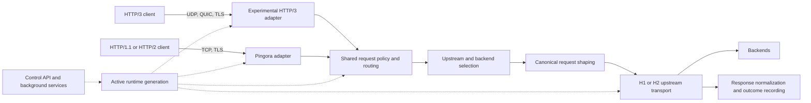

# Architecture Overview

Impulse is a reverse proxy built on Pingora for production HTTP/1.1 and HTTP/2
ingress. An independent, experimental HTTP/3 adapter accepts QUIC traffic over
UDP. Both ingress adapters use the same
runtime generation, policy, routing, backend-selection, transport, and outcome
contracts.

## Architecture Pages

| Question | Page |
| --- | --- |
| How is the system divided and which crate owns each boundary? | This page |
| What happens to one request? | [Request Lifecycle](/docs/architecture/request-lifecycle) |
| How does configuration become active runtime state? | [Runtime Generation and Configuration Lifecycle](/docs/architecture/runtime-generation) |
| How are H1/H2 upstream execution and backend state managed? | [Transport and Backend Lifecycle](/docs/architecture/transport-and-backend-lifecycle) |

## System Shape

The data plane accepts, evaluates, routes, and forwards requests. The control
plane validates and activates configuration, exposes runtime state and metrics,
runs health, Domain Name System (DNS), and certificate work, and coordinates
drain or restart behavior.
Control-plane services read the same active generation as request workers.

## Ingress Boundaries

| Concern | HTTP/3 ingress | Pingora ingress |
| --- | --- | --- |
| Downstream wire protocol | HTTP/3 over QUIC on UDP | HTTP/1.1 or HTTP/2 over TCP/TLS |
| Ingress ownership | QUIC handshake, connection IDs, packets, and H3 streams | Pingora TCP/TLS accept and H1/H2 session handling |
| Request policy | Shared | Shared |
| Routing and backend selection | Shared | Shared |
| Upstream transport | Shared H1/H2 façade | Shared H1/H2 façade |
| Response egress | H3 stream writes | HTTP/1.1 or HTTP/2 response writes |
| Upgrade behavior | No HTTP/1.1-style upgrade semantics | HTTP/1.1 WebSocket/upgrade handling where supported |

Pingora ingress is the production H1/H2 adapter, not a second policy engine.
Protocol-specific parsing, connection management, and response writeback remain
local to each adapter; policy meaning and backend execution should not diverge.

## Workspace Ownership

Protocol adapters live in `impulse-pingora-ingress` and
`impulse-http3-ingress`. `impulse-edge` owns shared request execution;
`impulse-plugins` and `impulse-policy` own compiled policy; `impulse-runtime`
owns generation lifecycle; and `impulse-operations` owns administrative
services. Bridge, transport, and load-balancing crates retain their narrow data
plane responsibilities.

## State and Concurrency

The binary starts one managed listener group per configured listener. HTTP/3
workers use UDP sockets and may use packet shards; Pingora accepts TCP
traffic for the same listener identity. Backend I/O and control work run on
Tokio runtimes.

Workers read an immutable `RuntimeBundle` through `RuntimeBundleHandle`. A
successful activation publishes a whole new bundle; readers holding the prior
bundle can finish without observing a partially updated configuration. Backend
and process services have explicit generation or process ownership described in
[Runtime Generation and Configuration Lifecycle](/docs/architecture/runtime-generation).

## Architectural Rules

- Keep ingress-specific wire mechanics in the Pingora or HTTP/3 adapter.
- Keep request policy and outcome meaning shared across both adapters.
- Do not infer upstream protocol in `edge`; consume normalized config and the
  transport façade.
- Do not let transport own routing, admission, retries, or durable health state.
- Do not reconstruct active state from listener-local fields; read the active
  runtime generation.
- Keep exact configuration and endpoint contracts in their reference pages,
  not in architecture prose.

## Related Pages

- [Configuration Reference](/docs/configuration/reference)
- [Control API Reference](/docs/reference/control-api-reference)
