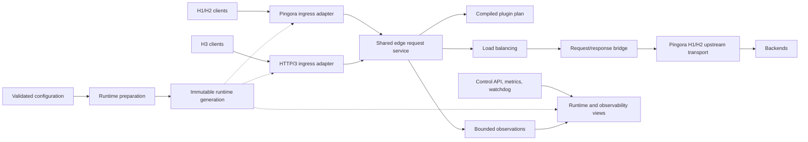

# Architecture Overview

Impulse separates protocol I/O from shared proxy decisions. Pingora provides
production HTTP/1.1 and HTTP/2 ingress. A separate adapter provides
experimental HTTP/3. Both pin one runtime generation and call the same edge
request service.

## System Shape

The request path reads prepared state. It does not parse configuration, build
policies, start services, or reconstruct the active generation.

## Ownership

| Owner | Responsibility |
| --- | --- |
| `impulse` | Configuration source, process startup, signals, privilege dropping, and exit status |
| `impulse-config` | YAML schema, validation, secret resolution, and normalized runtime inputs |
| `impulse-runtime` | Generation identity and lifecycle state contracts |
| `impulse-edge` | Runtime supervision, shared routing, request execution, retry coordination, response processing, and exactly-once completion |
| `impulse-pingora-ingress` | Pingora listener integration and H1/H2 downstream translation |
| `impulse-http3-ingress` | QUIC workers and HTTP/3 downstream translation |
| `impulse-contracts` | Dependency-light identities, decisions, outcomes, and plugin views |
| `impulse-plugins` | Compiled phase plans and plugin execution |
| `impulse-policy` | Protocol-neutral policy evaluation and policy-owned state |
| `impulse-lb` | Backend membership, readiness, selection, and pool accounting |
| `impulse-bridge` | Canonical Host, forwarding, framing, trailer, and normalization rules |
| `impulse-transport` | Upstream identities, Pingora H1/H2 sessions, pooling, reuse, and exchange lifecycle |
| `impulse-operations` | Control API, metrics endpoint, administrative security, and watchdog services |
| `impulse-observability` | Bounded labels, metrics, snapshots, rendering, and recording APIs |

No ingress adapter owns routing, policy state, backend health, retries, or
terminal outcomes. No operations service owns mutable request-path state.

## Ingress Adapters

| Boundary | Pingora | HTTP/3 |
| --- | --- | --- |
| Status | Production H1/H2 | Experimental H3 |
| Network I/O | TCP, TLS, ALPN, Pingora sessions | UDP, QUIC, TLS, H3 streams |
| Adapter work | Connection filtering, request/response translation, downstream tunnels | Packet workers, stream parsing, response framing, downstream tunnels |
| Shared work | Route, plugins, admission, backend selection, upstream execution, response policy, completion | Same |

Adapters expose borrowed request views and translate typed edge decisions back
to their wire protocol. Bodies, sockets, sessions, and connection-close permits
remain protocol-owned.

## Shared Request Service

For each request, edge:

1. pins the active generation and validates normalized request metadata
2. resolves the route and its generation-owned policy plan
3. executes request plugins once, before retry attempts
4. applies mandatory overload admission
5. selects an eligible backend through `impulse-lb`
6. builds and executes the upstream exchange through bridge and transport
7. applies shared response policy while the host retains body I/O
8. records one terminal outcome and releases accounting

Retries can select another backend and repeat an upstream attempt. They do not
repeat client-request authentication, rate-limit, or quota plugins.

## Compiled Plugin Runtime

During generation preparation, validated configuration is converted into
plugin-owned inputs and compiled into fixed, phase-specific enums. The host
sets security-sensitive ordering; configuration cannot reorder plugins.

Each generation owns immutable connection, synchronous request, asynchronous
request, cache, and response plans. Empty phases have a direct fast path.
Plugins return decisions, validated header mutations, and bounded observations;
they do not own bodies, retries, downstream writes, or request completion.

Cargo features determine which plugin kinds exist in a binary. Startup and
reload reject configuration that requires an unavailable kind before the
candidate generation is published. See
[Plugin Build Profiles](/docs/configuration/plugin-builds) for exact features,
build commands, and runtime status fields.

## Runtime Generations

A generation groups the route index, compiled plugin plans, backend views,
load balancers, transport pools, cache namespace, TLS material, and owned
background tasks needed by its requests.

Startup prepares the first complete generation before listeners serve traffic.
Activation prepares a candidate before atomically publishing it; failure leaves
the active generation unchanged. Requests retain their pinned generation until
completion. Retirement drains generation-owned tasks, while rollback prepares
and publishes a new generation from retained state.

Process-owned services are carried across generations only when continuity is
required. Startup-owned changes are rejected during live activation.

## Load Balancing and Transport

`impulse-lb` decides which ready backend should receive an attempt. It owns
selection algorithms, health readiness, retry exclusions, discovery membership,
and selection accounting. It does not open connections or execute HTTP.

`impulse-transport` realizes the selected backend. It owns connection identity,
TLS and proxy settings, Pingora H1/H2 sessions, pooling, multiplexing, reuse,
rotation, cancellation, and upstream tunnel leases. It does not route requests,
run plugins, or decide retries.

The bridge between them applies the canonical HTTP transformation rules without
owning either selection or network sessions.

## Operations and Observability

The runtime supervisor starts, activates, drains, and stops listener and
operational services. `impulse-operations` exposes the Control API and metrics
endpoint through narrow runtime and observability views; administrative
authentication is separate from traffic authentication.

Request, policy, ingress, and runtime layers emit observations through bounded
recording APIs. `impulse-observability` owns label vocabularies and rendering,
so traffic-derived credentials, authorities, subjects, and arbitrary plugin
instance names do not become metric labels.

## Architectural Rules

- Protocol mechanics stay in ingress adapters.
- Shared request meaning stays in edge.
- Plugin plans and runtime resources never mix generations.
- Load balancing selects; transport connects and exchanges.
- Bodies and connection-close ownership remain with the host that can observe them.
- Plugins cannot retry, complete, log, or finalize requests independently.
- Operational services consume views rather than ingress or transport internals.

## Focused Pages

- [Request Lifecycle](/docs/architecture/request-lifecycle)
- [Runtime Generation and Configuration Lifecycle](/docs/architecture/runtime-generation)
- [Transport and Backend Lifecycle](/docs/architecture/transport-and-backend-lifecycle)
- [Protocol Support](/docs/protocols/support)
- [Control Plane](/docs/operations/control-plane)
